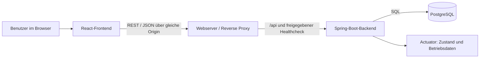
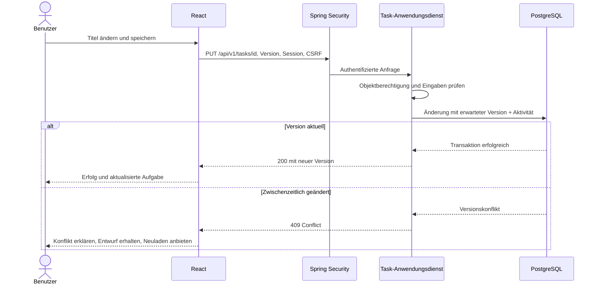

# Architektur

[Zur Übersicht](../README.md) · [Entscheidungen](adr/README.md)

**Status:** Verbindliches Zielbild. Die Module `common` und `user` (seit M0/M1a), `task` (seit M1b), `project` und `tag` (seit M1c) sowie die Mitgliedschaft/Zuweisung in `project`/`task` (seit M2, US-060 bis US-062) sind umgesetzt; `notification` ist weiterhin Planung.

## Das System erklären

Ein **Frontend** stellt die Oberfläche dar. Das **Backend** bearbeitet Anfragen, prüft Rechte und setzt Regeln durch. Die **Datenbank** speichert Daten dauerhaft. Ein modularer Monolith trennt Fachgebiete im Code, betreibt sie aber als eine gemeinsame Backend-Anwendung.



Der Webserver liefert auch die gebauten Frontend-Dateien aus. Eine **Origin** ist die Kombination aus Protokoll, Host und Port. Frontend und API nutzen im späteren Betrieb dieselbe Origin; das vereinfacht sichere Cookies und verhindert unnötige CORS-Konfiguration. Lokal leitet Vite `/api` an das Backend weiter. TLS/HTTPS ist für einen Einsatz außerhalb von localhost erforderlich.

## Geplante Verzeichnisse

```text
src/
├── backend/
│   ├── pom.xml
│   ├── mvnw, mvnw.cmd, .mvn/wrapper/
│   └── src/
│       ├── main/java/.../
│       │   ├── user/{api,application,domain,persistence}/
│       │   ├── project/{api,application,domain,persistence}/
│       │   ├── task/{api,application,domain,persistence}/
│       │   ├── tag/{api,application,domain,persistence}/
│       │   ├── notification/{api,application,domain,persistence}/
│       │   └── common/
│       ├── main/resources/db/migration/
│       └── test/
└── frontend/
    ├── package.json, package-lock.json
    └── src/
        ├── features/{auth,tasks,projects,tags}/
        ├── components/
        ├── api/
        ├── hooks/
        └── pages/
```

Diese Pfade entstehen erst bei Implementierung. `compose.yaml`, `compose.dev.yaml`, `.env.example` und Container-Build-Dateien werden in M0 ergänzt. `compose.yaml` betreibt `web`, `backend` und `db`; die **eigenständige** `compose.dev.yaml` startet nur `db` für die Entwicklung auf dem Host.

## Module und Abhängigkeiten

| Modul | Verantwortung | Erlaubte Zusammenarbeit |
|---|---|---|
| `user` | Konto, Passwort, Anmeldung, Kontostatus | Kennt keine Aufgabeninhalte |
| `project` | Projekte, Eigentümer, Mitgliedschaften | Nutzt öffentliche Benutzerabfragen |
| `task` | Aufgaben, Tag-Zuordnung (`TaskTag`), Unteraufgaben, Kommentare, Aktivitäten, Wiederholungen | Nutzt Benutzer-, Projekt- und Tag-Berechtigungen |
| `tag` | Tags (persönlich oder projektbezogen), Namensregeln je Geltungsbereich | Nutzt öffentliche Projektabfragen zur Eigentümerprüfung |
| `notification` | Erinnerungen und persönliche In-App-Mitteilungen | Prüft Aufgabenstatus und Berechtigung über öffentliche Schnittstellen |
| `common` | Kleine gemeinsame Typen, Uhr, Fehlerformat | Enthält keine heimliche Sammelstelle für Fachlogik |

Kein Modul greift direkt auf das Repository eines anderen Moduls zu. Öffentliche Anwendungsdienste liefern schmale Datenmodelle; kreisförmige Abhängigkeiten sind zu vermeiden. Eine Datenbank und ein gemeinsamer Prozess erlauben lokale Transaktionen. Ein separater Message Broker ist nicht vorgesehen.

Innerhalb eines Moduls nimmt `api` HTTP-Anfragen entgegen. `application` koordiniert Berechtigungsprüfung, Fachregeln und Transaktion. `domain` beschreibt Begriffe und Regeln. `persistence` übernimmt Speicherung und Abfragen. Für den Einstieg dürfen einfache Fachobjekte zugleich JPA-Entities sein; eine doppelte Modellwelt ist nicht Pflicht. Entities verlassen trotzdem nie ungefiltert die API. Spring Data JPA ist hierfür eine Arbeitsannahme, die ADR-002 benennt.

## Beispiel: Aufgabe speichern



Frontend-Validierung hilft beim Ausfüllen, ersetzt aber nie die Backend-Prüfung. Versionsprüfung und Transaktion verhindern, dass zwei Bearbeiter sich unbemerkt überschreiben. Suchabfragen und Zähler filtern bereits in der Datenbank nach Zugriffsrechten.

## Betrieb und Querschnittsthemen

- **Authentifizierung:** Serverseitige Session mit Cookie; CSRF-Schutz für Änderungen. Details in [SECURITY.md](SECURITY.md).
- **Daten:** PostgreSQL mit persistentem Volume. Flyway führt nummerierte Migrationen aus; keine automatische Schemaänderung durch Hibernate im Betrieb.
- **Betriebszustand:** Actuator liefert einen minimalen Healthcheck. Readiness berücksichtigt die Datenbank, Liveness nicht deren vorübergehenden Ausfall.
- **Fehler:** Einheitliches JSON-Fehlerformat mit stabilem Fehlercode; keine Stacktraces im Browser. Eine Anfragekennung verbindet Fehler und bereinigte Logs.
- **Zeit:** Technische Zeitpunkte in UTC; fachliche Fälligkeit mit ausdrücklich behandelter Zeitzone. Eine austauschbare Uhr macht Zeitregeln testbar.
- **Jobs:** Erinnerungen zunächst im Backend-Prozess; Zustand dauerhaft speichern und doppelte Verarbeitung durch Datenbankregeln verhindern.
- **Frontend:** Lokaler React-Zustand genügt zunächst. Lade-, Leer-, Fehler- und Konfliktzustände sind Teil jedes Features. Keine Fachrechte allein im Browser.
- **Barrierefreiheit:** Gemeinsame zugängliche Formulare, Dialoge und Statusmeldungen; automatisierte und manuelle Prüfungen ab M0.

Eine Backend-Instanz ist das erste Betriebsziel. Neustarts dürfen Sitzungen beenden, aber keine Fachdaten verlieren. Mehrere Backend-Instanzen würden zusätzliche Entscheidungen über Sessions und Job-Koordination erfordern.

## Lernfragen

Erkläre den Weg einer Speicheranfrage, den Unterschied zwischen Anmeldung und Berechtigung sowie die Aufgabe einer Transaktion. Zeige danach im Diagramm, welche Komponente bei einem Datenbankausfall betroffen ist und wie der Betreiber das erkennt.
