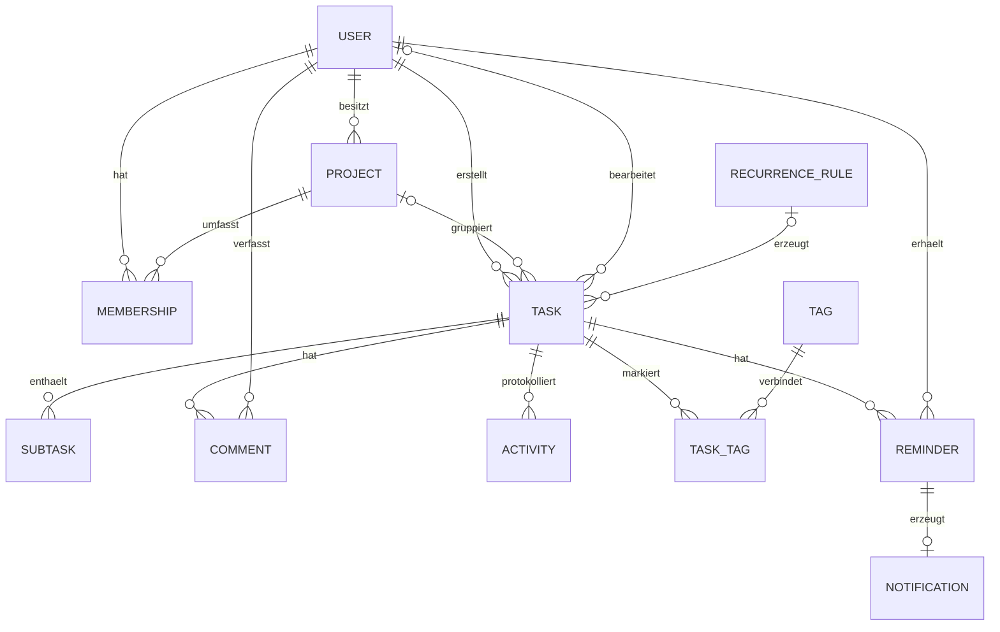

# Fachliches Datenmodell

[Zur Übersicht](../README.md) · [Backlog](../BACKLOG.md) · [Sicherheitsmodell](SECURITY.md)

**Status:** `User` (V2), `Task` (V3), `Project` (V4), `Tag`/`TaskTag` (V5), `Membership`/`Task.assigneeId` (V6), `Subtask` (V7) und `Comment`/`Activity` (V8) sind als Datenbankschema umgesetzt (siehe Flyway-Migrationen unter `src/backend/src/main/resources/db/migration/`). Ein Projekt hat genau einen Eigentümer, dazu beliebig viele Mitglieder über `Membership`. `RecurrenceRule`, `Reminder` und `Notification` sind weiterhin reines Planungsmodell ohne Schema. Die Begriffe und Kernfunktionen stammen aus der gemeinsamen Planung. Die nachfolgend markierten Arbeitsannahmen konkretisieren bisher offene Details und gelten als Startvorgaben für die betroffenen Stories.

## Begriffe und Beziehungen

Ein **Projekt** bündelt Aufgaben. Eine **Mitgliedschaft** erlaubt Zusammenarbeit. Eine **Unteraufgabe** ist eine einfache Checkliste innerhalb einer Aufgabe, keine weitere vollständige Aufgabe. Eine **Aktivität** dokumentiert eine fachliche Änderung; sie ist kein technisches Serverlog.

`o|` bedeutet „kein oder ein“, `o{` bedeutet „keine oder viele“. Technische Hilfstabellen, etwa für Reset-Tokens, sind im Übersichtsdiagramm ausgelassen.

## Datenobjekte

| Objekt | Wesentliche Felder | Wichtige Regel |
|---|---|---|
| `User` | ID, Login-E-Mail, Anzeigename, Passwort-Hash, `ACTIVE/INACTIVE`, `USER/ADMIN`, Zeitzone, erstellt/geändert | Login eindeutig; niemals Passwort oder Hash an die API ausgeben |
| `Project` | ID, Name, Beschreibung, Eigentümer-ID, erstellt/geändert, Version | Genau ein Eigentümer; Eigentum ist keine globale Administratorrolle |
| `Membership` | Projekt-ID, Benutzer-ID, Aufnahmezeitpunkt | Paar aus Projekt und Benutzer eindeutig; Eigentümer hat unabhängig davon Zugriff |
| `Task` | ID, Titel, Beschreibung, Status, Priorität, optional Projekt und Bearbeiter, Ersteller, Fälligkeit, erstellt/geändert/erledigt, Version | Ersteller unveränderlich; Rechte über Projekt oder persönliche Eigentümerschaft |
| `Subtask` | ID, Aufgabe, Titel, erledigt, Reihenfolge | Genau eine Ebene; keine rekursiven Unteraufgaben |
| `Comment` | ID, Aufgabe, Autor, Inhalt, erstellt | Gleiche Leseberechtigung wie Aufgabe; Inhalt als Text behandeln; nie nachträglich geändert |
| `Tag` / `TaskTag` | ID, Name, persönlicher oder Projekt-Geltungsbereich; Zuordnung | Keine globale Liste, die private Begriffe verrät |
| `Activity` | ID, Aufgabe, Zeitpunkt, handelnder Benutzer, Art, freigegebene Änderungsdaten | Zusammen mit Fachänderung speichern; nicht durch Benutzer editierbar |
| `RecurrenceRule` | ID, Rhythmus, Ankerdatum, Zeitzone, aktiv | Eine gemeinsame Regel verbindet mehrere konkrete Aufgabeninstanzen |
| `Reminder` | ID, Aufgabe, Empfänger, Offset, berechneter Zeitpunkt, Status, Fälligkeitsrevision | Ein Benutzer konfiguriert eigene Erinnerungen; Zustand übersteht Neustarts |
| `Notification` | ID, Erinnerung, Empfänger, erstellt/gelesen | In-App-Mitteilung; kein garantierter Push bei geschlossenem Browser |

Technische IDs sind undurchsichtige UUIDs. Sie ersetzen keine Rechteprüfung. Zeitstempel werden serverseitig gesetzt. Datenbank-Constraints sichern Pflichtfelder, Eindeutigkeit und Beziehungen zusätzlich zur Anwendungsprüfung.

## Aufgabenstatus und Priorität

Statuswerte: `OPEN` (offen), `IN_PROGRESS` (in Bearbeitung), `DONE` (erledigt). Neue Aufgaben starten mit `OPEN`. Prioritäten: `LOW`, `NORMAL`, `HIGH`, `URGENT`; Standard ist `NORMAL`. Die Sortierung folgt dieser expliziten Rangfolge und nicht dem Alphabet.

Arbeitsannahme: Jeder Wechsel zwischen den drei Statuswerten ist erlaubt. Beim Wechsel nach `DONE` wird `completedAt` gesetzt, beim Verlassen geleert. Ein erneutes Abschließen derselben erledigten Instanz ist wirkungslos und erzeugt weder einen weiteren Abschlusszeitpunkt noch einen zweiten Nachfolger. Vollständig abgehakte Unteraufgaben erledigen die Hauptaufgabe nicht automatisch.

**Umgesetzt in M2 (US-070/071), normale technische Umsetzungsentscheidungen:** Unteraufgaben gehören zum `task`-Modul, nicht zu einem eigenen Modul (siehe [ARCHITECTURE.md](ARCHITECTURE.md)); Rechte prüft `SubtaskService` ausschließlich über die bereits vorhandene Zugriffsprüfung der Hauptaufgabe, ohne sie zu duplizieren. Die Reihenfolge (`sort_order`) ist bewusst nicht als datenbankweit eindeutig erzwungen — Gleichstände löst die Unteraufgaben-ID auf (Muster wie bei anderen Listen, z. B. `createdAt`/`id`) — damit ein Vertauschen zweier Positionen ohne `DEFERRABLE`-Constraint möglich bleibt. Der Fortschritt (`TaskResponse.subtasks`, „X von Y erledigt“) ändert bewusst nicht `version`/`updatedAt` der Aufgabe, analog zur Tag-Regel weiter unten.

**Umgesetzt in M2 (US-080/081):** Kommentar und zugehörige `COMMENTED`-Aktivität entstehen in derselben Transaktion (`CommentService.create`), beide gehören zum `task`-Modul. Bearbeiter- und Projektname in `ASSIGNEE_CHANGED`/`PROJECT_CHANGED`-Einträgen werden zum Zeitpunkt der Änderung aufgelöst und als Text gespeichert (nicht als ID) — eine spätere Umbenennung oder Entfernung des Bearbeiters/Projekts ändert die Historie nicht rückwirkend, vergleichbar mit einem Zeitungsartikel, der den damaligen Stand festhält. Ändert eine einzelne Anfrage mehrere Felder gleichzeitig (z. B. Titel und Priorität im selben Bearbeitungsformular), teilen sich deren Aktivitätseinträge denselben Zeitstempel; ein wachsender Versatz von je einer Mikrosekunde macht ihre Reihenfolge trotzdem deterministisch entsprechend der Prüfreihenfolge im Code, statt sie der zufälligen Aktivitäts-ID zu überlassen (normale technische Umsetzungsentscheidung). Eine Änderung der Beschreibung erzeugt bewusst keinen Aktivitätseintrag, da sie im Akzeptanzkriterium von US-081 nicht genannt ist.

## Rechte, persönliche Aufgaben und Projektlöschung

Arbeitsannahmen für US-022, US-042 und US-060 bis US-062:

- Eine Aufgabe ohne Projekt gehört ihrem Ersteller und ist nur für ihn sichtbar. Als Bearbeiter sind hier nur der Ersteller oder niemand erlaubt.
- Eine Projektaufgabe ist für Eigentümer und aktuelle Mitglieder lesbar und bearbeitbar. Alle dürfen Aufgaben anlegen, bearbeiten, kommentieren und löschen; Projektverwaltung und Mitgliederverwaltung bleiben beim Eigentümer.
- Eine Zuweisung allein erteilt kein Zugriffsrecht. Nur aktive, aktuell berechtigte Projektbenutzer dürfen zugewiesen werden.
- Entfernte Mitglieder verlieren sofort den Zugriff; ihre Zuweisungen in diesem Projekt werden in derselben Transaktion entfernt. Ihre früheren Kommentare und Aktivitäten bleiben erhalten.
- Beim Löschen eines Projekts bleiben seine Aufgaben bestehen. Sie werden ohne Projekt zu persönlichen Aufgaben ihres jeweiligen Erstellers. Fremde Zuweisungen, Projekt-Tags und Erinnerungen nun unberechtigter Empfänger werden entfernt. Kommentare und Aktivitäten bleiben bei der Aufgabe und werden für frühere Mitglieder unzugänglich.
- Der Löschdialog erklärt diese Folge ausdrücklich. Auch Aufgaben deaktivierter Ersteller bleiben erhalten; Reaktivierung stellt deren persönlichen Zugriff wieder her.
- Eine bestehende Aufgabe darf nur ihr Ersteller oder der Eigentümer ihres aktuellen Projekts verschieben. Für das Zielprojekt muss der Handelnde ebenfalls berechtigt sein. Eine neue persönliche Aufgabe kann nur ihr Ersteller einem Projekt zuordnen. Ein Verschieben entfernt unzulässige Zuweisungen, Tags und Erinnerungen und meldet dies vor Bestätigung.
- Globale Administratoren verwalten Kontostatus und Systemzustand. Sie erhalten keinen automatischen Zugriff auf private Projekte oder Aufgaben.

Beim späteren Ändern dieser Regeln müssen API, UI, Tests und Dokumentation gemeinsam angepasst werden. Die frühere Vorgabe „Projekt löschen löscht Aufgaben nicht“ bleibt dabei verbindlich.

**Umgesetzt in M2 (US-060 bis US-062), löst die frühere M1c-Vereinfachung ab:** `Membership` (V6) macht „Eigentümer und aktuelle Mitglieder“ real; „zugänglich“ (`ProjectRepository.ACCESSIBLE_CONDITION`, wiederverwendet in `TaskRepository`) prüft seither Eigentümer *oder* Mitgliedschaft, nicht mehr nur Eigentümer. Für die Unterscheidung zwischen unbekannt/fremd und bekannt/nicht-berechtigt gilt: eine für den Handelnden nicht zugängliche Projektaufgabe oder ein nicht zugängliches Projekt liefert weiterhin `404` (er hat gar keine Beziehung dazu); versucht ein zugängliches Mitglied ohne Eigentümerrechte eine eigentümerspezifische Aktion (Mitglied aufnehmen/entfernen, Projekt löschen/umbenennen), liefert die API bewusst `403` statt `404` (`ProjectService.loadOwned`) — die Zugehörigkeit ist ihm bekannt, nur die Handlung bleibt ihm verwehrt. Zuweisung folgt denselben Regeln wie oben beschrieben (nur Eigentümer/aktuelle Mitglieder eines Projekts, bei persönlichen Aufgaben nur der Ersteller); ein Verschieben zwischen Projekten ist enger geregelt als übrige Bearbeitung — nur Ersteller oder Eigentümer des *aktuellen* Projekts dürfen verschieben, und das Zielprojekt muss dem Handelnden zugänglich sein (`TaskService.requireCanChangeProject`). Entfernen eines Mitglieds bereinigt dessen Zuweisungen im Projekt transaktional (`TaskProjectSupport.unassignUser`); Projektlöschung bereinigt zusätzlich alle Mitgliedschaften und projektbezogenen Tags (`ProjectTagSupport.deleteAllForProject`). Erinnerungen bleiben in beiden Fällen ohne Wirkung, da die Erinnerungsfunktion selbst erst mit M3/US-100 entsteht.

**Arbeitsannahmen für US-043 (Tags), umgesetzt in M1c:** Ein Tag gehört entweder genau einem Benutzer persönlich oder genau einem seiner eigenen Projekte, nie beidem (Datenbank-Constraint). Nur der Eigentümer des Projekts darf projektbezogene Tags anlegen, umbenennen oder löschen; persönliche Tags stehen ausschließlich ihrem Ersteller zur Verfügung. Das Ersetzen der Tag-Zuordnung einer Aufgabe (`PUT /api/v1/tasks/{id}/tags`) ändert bewusst nicht deren `version`/`updatedAt` — Tags gelten als reine Markierung ohne fachliche Auswirkung auf den Bearbeitungsstand der Aufgabe, anders als Titel, Beschreibung, Status, Priorität und Fälligkeit. Löschen eines Tags oder einer Aufgabe entfernt nur die Zuordnung in `task_tag`, nie die jeweils andere Seite. Diese Einordnung ist eine normale technische Umsetzungsentscheidung ohne abweichende fachliche Wirkung und wurde daher ohne separate Rückfrage getroffen.

## Eingaben und Grenzen

Arbeitsannahmen, einheitlich in Frontend, Backend, OpenAPI und Datenbank umzusetzen:

| Feld | Regel |
|---|---|
| Titel / Unteraufgabentitel | Nach Entfernen äußerer Leerzeichen 1–200 Zeichen |
| Aufgabenbeschreibung / Projektbeschreibung | Optional, höchstens 10.000 Zeichen |
| Projektname / Anzeigename | 1–100 Zeichen |
| Kommentar | 1–5.000 Zeichen; keine reinen Leerzeichen |
| Tag | 1–50 Zeichen; innerhalb seines Geltungsbereichs ohne Beachtung der Großschreibung eindeutig |
| Login-E-Mail | Pflichtfeld, höchstens 254 Zeichen; für Anmeldung trimmen und kleinschreiben, per Unique Constraint absichern |
| Listenabfrage | Standard 25, maximal 100 Einträge pro Seite; stabile Zweitsortierung nach ID |

Beschreibungen und Kommentare sind zunächst reiner Text. Kein HTML, Dateiupload oder Markdown-Rendering erforderlich. Internationale Namen und Umlaute sind erlaubt. Feldlängen zählen Unicode-Codepoints; Byte-Grenzen bei Passwörtern sind davon getrennt zu behandeln.

## Fälligkeit und Zeitzonen

Arbeitsannahmen für US-037, US-053 und US-100:

- Ein Datum ist optional. Eine Uhrzeit benötigt immer ein Datum und eine gespeicherte IANA-Zeitzone, beispielsweise `Europe/Berlin`.
- Die Kontozeitzone wird bei Registrierung gewählt oder aus dem Browser vorgeschlagen; sie darf nicht stillschweigend aus der Serverzeitzone stammen. Das Ändern des Profils verschiebt bestehende Aufgaben nicht.
- Ohne Uhrzeit gilt eine Aufgabe bis zum Ende ihres Fälligkeitstags in ihrer gespeicherten Zeitzone als rechtzeitig. Mit Uhrzeit entscheidet der zugehörige Zeitpunkt. `DONE` ist nie überfällig.
- „Heute“ und „Demnächst“ beziehen sich auf Kalendertage in der Kontozeitzone des Betrachters. Datumsaufgaben behalten ihr Datum; Zeitpunkte werden für die Anzeige umgerechnet. „Demnächst“ zeigt die nächsten sieben Tage ohne heute.
- Nicht existierende lokale Uhrzeiten bei Sommerzeitwechsel werden abgewiesen. Bei einer doppelt vorkommenden Uhrzeit muss die Oberfläche den gewählten Offset sichtbar machen und eine eindeutige Auswahl ermöglichen.
- Technische Zeitpunkte wie `createdAt` werden in UTC gespeichert und in ISO-8601-Form übertragen. Ein reines Fälligkeitsdatum bleibt ein Datum, kein erfundener Mitternachtszeitpunkt.

**Umgesetzt in M1b (Task-Modul), bestätigte Arbeitsannahmen:**

- **Überfällig ab genau dem Fälligkeitszeitpunkt.** Bei Uhrzeit gilt: überfällig, sobald der aktuelle Zeitpunkt den Fälligkeitszeitpunkt erreicht oder überschritten hat (nicht erst danach). Ohne Uhrzeit gilt Überfälligkeit ab dem Beginn des Folgetags in der gespeicherten Zeitzone.
- **Die Zeitzone einer Fälligkeit ist ein Pflichtfeld des Clients**, sobald ein Datum gesetzt wird; das Frontend belegt sie mit der Kontozeitzone vor, sendet sie aber immer explizit mit. Das Backend-Modul `task` fragt dafür nicht beim Modul `user` nach (Modulgrenze, siehe [ARCHITECTURE.md](ARCHITECTURE.md)); fehlt die Zeitzone in der Anfrage, wird das als Validierungsfehler abgewiesen, nicht stillschweigend ergänzt.
- **Erledigen ist idempotent.** Ist eine Aufgabe bereits `DONE`, wird ein erneuter „Erledigen“-Aufruf nicht anhand der Version geprüft; er ändert nichts und liefert unverändert die aktuelle Fassung zurück (kein `409` bei Doppelklick oder zwei geöffneten Tabs). Symmetrisch dazu ist „Wieder öffnen“ auf einer nicht erledigten Aufgabe wirkungslos, ebenfalls ohne Versionsprüfung.
- Diese drei Punkte wurden vor der Umsetzung von M1b mit dem Auftraggeber bestätigt (30.09.2026).

**Umgesetzt in M1c (US-050 bis US-053), normale technische Umsetzungsentscheidung:** Der Fälligkeitsbereichs-Filter (`dueDateFrom`/`dueDateTo`) und die Standardansichten „Heute“/„Demnächst“ vergleichen das rohe, gespeicherte Fälligkeitsdatum (`dueDate`), nicht den um einen Tag verschobenen Überfällig-Zeitpunkt — konsistent mit „Datumsaufgaben behalten ihr Datum“ oben. „Heute“/„Demnächst“ lösen die Kalendertage weiterhin im Client in dessen Kontozeitzone auf und senden sie explizit als Datumsgrenzen; „Überfällig“ nutzt stattdessen das serverseitige `overdue`-Flag (Instant-Vergleich, siehe oben), da dieser Vergleich bereits zeitzonenunabhängig korrekt ist.

## Wiederholungen und Erinnerungen

Arbeitsannahmen für M3; vor Umsetzung mit Beispielen in Tests festhalten:

- Erste Rhythmen: täglich, wöchentlich, monatlich; weitergehende Regeln wie „alle 14 Tage“ sind spätere Erweiterungen.
- Wiederholung benötigt ein Fälligkeitsdatum. Beim ersten Abschließen einer Instanz wird genau ein Nachfolger in derselben Transaktion erzeugt. Die Folge wird vom ursprünglichen Anker aus berechnet; überfällige Zwischenvorkommen werden übersprungen, bis die erste künftige Fälligkeit erreicht ist.
- Monatsrhythmen behalten den ursprünglichen Tag als Anker: 31. Januar → letzter Februartag → 31. März. Bei Zeitlücken durch Sommerzeit wird auf die erste gültige lokale Zeit danach verschoben; bei doppelter Zeit wird der frühere Offset gewählt und angezeigt.
- Der Nachfolger übernimmt Titel, Beschreibung, gültiges Projekt, gültige Zuweisung, Priorität, gültige Tags und Unteraufgabentitel; Status ist `OPEN`, Unteraufgaben sind offen. Kommentare, Aktivitäten und persönliche Erinnerungen werden nicht kopiert.
- Die Verbindung zum Nachfolger ist eindeutig. Wiederöffnen und erneutes Abschließen erzeugt keinen weiteren Nachfolger und löscht keine bereits erzeugte Aufgabe.
- Erinnerungen erfolgen zur Fälligkeit, 10 Minuten, eine Stunde oder einen Tag vorher. Datum ohne Uhrzeit verwendet dafür 09:00 Uhr in der Aufgabenzeitzone; die UI zeigt diese Annahme ausdrücklich.
- Beim Anlegen liegt der Erinnerungszeitpunkt in der Zukunft. Verschieben der Fälligkeit berechnet offene Erinnerungen neu; bereits verstrichene neue Termine werden als übersprungen markiert und angezeigt.
- Pro Empfänger, Erinnerung und Fälligkeitsrevision entsteht höchstens eine Mitteilung. Nach Neustart wird ein fälliger offener Reminder einmal nachgeholt, sofern Aufgabe offen und Zugriff vorhanden ist. Abschließen, Löschen und Berechtigungsentzug beenden ausstehende Erinnerungen.

## Konsistenz und Löschen

Optimistisches Sperren bedeutet: Ein Update enthält die zuletzt gelesene Version. Nur wenn sie noch aktuell ist, wird gespeichert. Andernfalls antwortet die API mit `409 Conflict`; der Browser bewahrt den Entwurf und bietet Neuladen an. Versionsprüfung gilt auch für Löschvorgänge. Gleichzeitige Änderungen an Mitgliedschaften und Aufgaben müssen so koordiniert werden, dass keine unzulässigen Zuweisungen zurückbleiben.

Arbeitsannahme: Aufgaben werden zunächst endgültig gelöscht; abhängige Unteraufgaben, Kommentare, Aktivitäten, Tag-Zuordnungen und Erinnerungen verschwinden transaktional. Eine Löschung ist keine Archivfunktion. Das Löschen einer wiederkehrenden Instanz erzeugt keinen Nachfolger. Konten werden in der ersten Version nur deaktiviert; eine vollständige Kontolöschung oder Eigentumsübertragung ist noch kein Feature.
