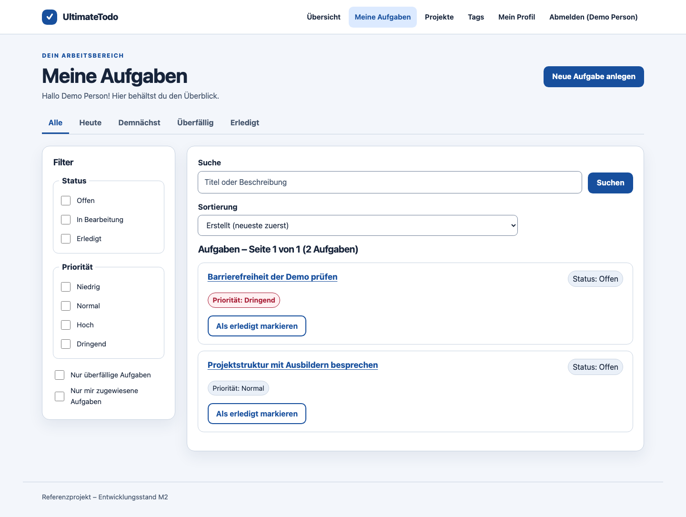
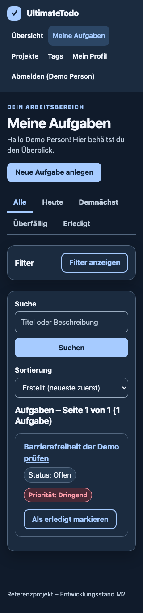

# US-180 – Visuelle Überarbeitung und Prüfstand

**Stand:** 30.09.2026 · Ausgangscommit `e41f738`, Änderungen noch nicht committet · Story `IN ARBEIT` bis zur manuellen Prüfung nach US-172.

## Umgesetzte Schritte

1. Ein gemeinsames helles und dunkles Farbsystem sowie Regeln für Schrift, Abstände, Navigation, Felder, Schaltflächen, Meldungen, Karten, Dialoge und Fokus eingeführt. Es wurde keine UI-Bibliothek ergänzt.
2. Die Aufgabenliste am Desktop in Filterspalte und Ergebnisbereich gegliedert. Aufgabenkarten trennen Titel, Status, Priorität, Termin und Handlung. Bei schmalem Viewport lassen sich die Filter über einen nativen Button mit `aria-expanded` und `aria-controls` öffnen; aktive Filter werden dabei als Anzahl angekündigt.
3. Übersicht, Projekt- und Taglisten, Anmelde- und Bearbeitungsformulare, Profil und Administration an dieselben Gestaltungsregeln angepasst. Die Administrationstabelle hat auf schmalen Bildschirmen einen beschrifteten, per Tastatur scrollbareren Bereich statt gequetschter Spalten.

## Sichtprüfung

Die Ansichten wurden mit synthetischen Konten und Aufgaben in einem **eigenen Compose-Projekt** (`ultimatetodo-ui-review`, eigener Port und eigenes Datenbankvolume) auf macOS 26.5.2 mit Playwright 1.63.0 und Chromium 153.0.8010.12 betrachtet. Das bestehende lokale Anwendungsvolume wurde nicht verwendet.

| Ansicht | Ergebnis |
|---|---|
| Aufgabenliste, 1440 CSS-Pixel, hell und dunkel | Filter und Ergebnisse stehen nebeneinander; aktive Ansicht, Hauptaktion und Aufgabenkarten sind klar erkennbar. Kein horizontaler Seitenüberlauf. |
| Aufgabenliste, 320 CSS-Pixel, dunkel | Filter zunächst kompakt, per Tastatur aufklappbar; Aufgaben erscheinen ohne lange Filterliste davor. Kein horizontaler Seitenüberlauf. |
| Anmeldung, neues Aufgabenformular, Übersicht | Seitenrahmen und Bedienelemente visuell geprüft; dieselben Regeln greifen auf allen drei Seiten. |
| Hauptseiten bei 320 CSS-Pixeln | Aufgabenliste, Übersicht, Aufgabe anlegen, Projektliste, Projekt anlegen, Tags und Profil ohne horizontalen Seitenüberlauf geprüft. |
| Hauptseiten mit 200 % Schriftgröße | Aufgabenliste, Übersicht, Aufgabe anlegen, Projekte, Tags und Profil bei 1280 CSS-Pixeln ohne horizontalen Seitenüberlauf geprüft. Dies simuliert Textvergrößerung, ersetzt keinen echten Browser-Zoom-Test. |
| Administration, 320 CSS-Pixel, dunkel | Tabelle behält lesbare Spalten. Die Seite selbst bleibt bei 320 CSS-Pixeln; die Tabelle hat 672 CSS-Pixel Inhalt in einem 286 CSS-Pixel breiten Scrollbereich und ließ sich nach Fokussieren mit Pfeil rechts um 40 CSS-Pixel verschieben. Ein axe-Scan ergab keine Regelverstöße im geprüften Zustand. |

## Nachprüfung am selben Abend

Nach einem Neubau des Compose-Stacks mit dem aktuellen Stand wurden im eingebauten Browser (schmaler Bereich, rund 580 CSS-Pixel) mit einem bestehenden Konto und einer Aufgabe folgende Ansichten betrachtet:

- Aufgabenliste (Desktopbreite, hell) und Aufgaben-Detailseite (hell) mit Fakten, Unteraufgaben und Verlauf.
- Löschen-Dialog im dunklen Schema: sichtbar, Fokus auf „Abbrechen“; nach dem Schließen liegt der Fokus wieder auf „Löschen“. Es wurde nichts gelöscht.
- Bearbeiten-Formular im dunklen Schema einschließlich der Fälligkeitsfelder; kein horizontaler Überlauf.
- Dabei fehlten Regeln für `history-list`, `history-meta` und `due-fields`; sie wurden in `styles.css` ergänzt und danach betrachtet (Verlaufseinträge als Karten mit Akzentrand).

**Nicht betrachtet:** Projektdetailseite und Mitgliederbereich (im Konto gab es kein Projekt; es wurden keine Daten angelegt), Kommentar mit mehreren Zeilen, Konflikt- und Fehlerzustände, Seiten bei 200 % Zoom. Der Frontend-Unit- und Playwright-Lauf wurde nach der CSS-Ergänzung nicht wiederholt.

## Kontrast und automatische Prüfungen

Die zentralen CSS-Farbpaare wurden nach der relativen WCAG-Leuchtdichte rechnerisch verglichen. Jeweils hell/dunkel: Fließtext auf Seitenfläche **14,36:1 / 15,96:1**, gedämpfter Text auf Karten **7,47:1 / 8,97:1**, Akzenttext auf Karten **7,95:1 / 8,61:1**, notwendige Eingabegrenzen auf Karten **3,96:1 / 6,32:1**, Fokusfarbe auf Karten **6,49:1 / 9,90:1**. Das ist eine Prüfung dieser Farbpaare, kein pauschaler Nachweis aller dargestellten Zustände.

| Prüfung | Tatsächliches Ergebnis |
|---|---|
| `npm run lint` | Erfolgreich. |
| `npm run typecheck` | Erfolgreich. |
| `npm run test:unit` | 114 von 114 erfolgreich im abschließenden Lauf. Ein früherer Lauf hatte einen nicht reproduzierten Fehler in `ProjectPages.test.tsx`; der gezielte Nachlauf und der abschließende Gesamtlauf waren grün. |
| `npm run build` | Erfolgreich; zusätzlich baute der Compose-Web-Container mit der festgelegten Node-Version 24.21.0. |
| Playwright gegen den isolierten Compose-Stack | 58 von 58 E2E-/axe-Tests erfolgreich. Enthalten ist ein neuer Test für den mobil per Tastatur öffnenden Filter im dunklen Schema. |
| `git diff --check` | Erfolgreich. |

Die lokalen npm-Befehle liefen mit Node 25.2.1; die im Projekt festgelegte Node-Version 24.21.0 wurde beim Container-Build verwendet. Der Browserprüflauf umfasst echte Frontend-, Backend- und PostgreSQL-Dienste.

## Noch offen

- Die manuelle Prüfung mit Screenreader und Browser sowie der echte Browser-Zoom-Test nach [ACCESSIBILITY.md](../ACCESSIBILITY.md) wurden nicht durchgeführt. Der Auftraggeber führt US-172 selbst durch und bestätigt sie.
- Die Story bleibt bis zu diesem Nachweis `IN ARBEIT`. Ein erfolgreicher axe-Scan allein ist kein Nachweis vollständiger WCAG-2.2-AA-Konformität.
